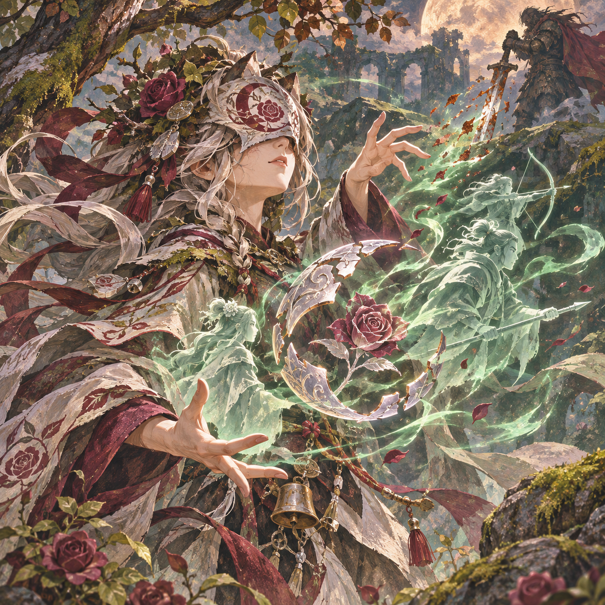
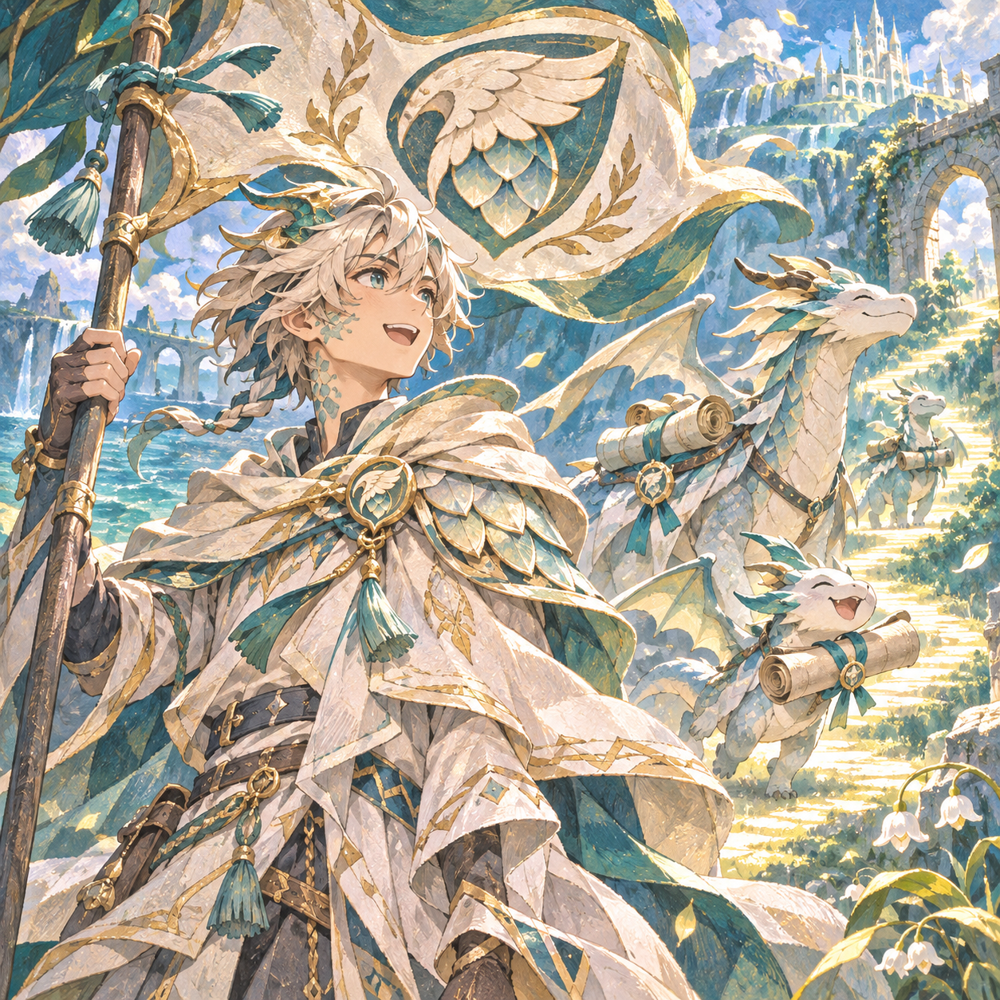
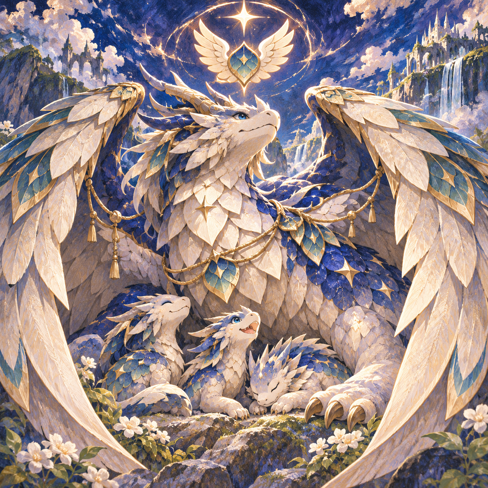
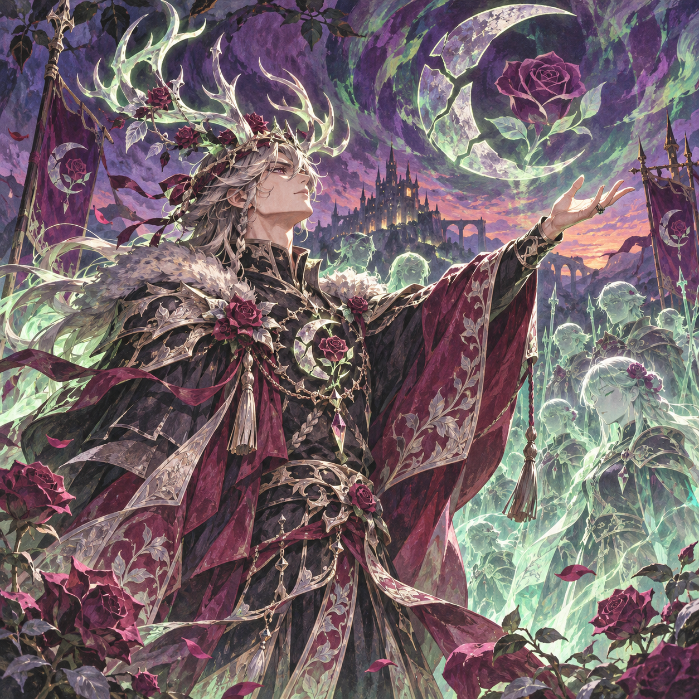

# 第4弾・先行イラスト9枚

このページは先行制作した9枚の記録です。現在は通常100種類＋生成・選択14種類の原画114枚を制作し、ゲームへ組み込み済みです。[全画像一覧](../artwork/set-4/index.html)を参照。

[名前案の全一覧](fourth-pack-names-and-art.md) · [制作データ・生成プロンプト](fourth-pack-creative.json)

| | | |
| --- | --- | --- |
| **FT-0577 夜継ぎの錆祓い**  | **FT-0580 露珠を継ぐ花告鳥**  | **FT-0607 夜継ぎの繕い番**  |
| **FT-0619 露珠の宵衣司祭**  | **FT-0630 露珠の拳継ぎ**  | **FT-0640 竜鱗の若き旗騎士**  |
| **FT-0647 銀環の刻印卵**  | **FT-0659 竜鱗の盾翼獣**  | **FT-0674 夜継ぎの黒薔薇帝**  |

画像生成：組み込みImageGen。各カードを別々に生成し、原画・ID・生成プロンプト・画像ハッシュを記録。既存画像の使い回しはない。

原作資料との照合と実装は[実装記録](fourth-pack-release.md)を参照。名前や絵の都合でカード性能を変更しない。
